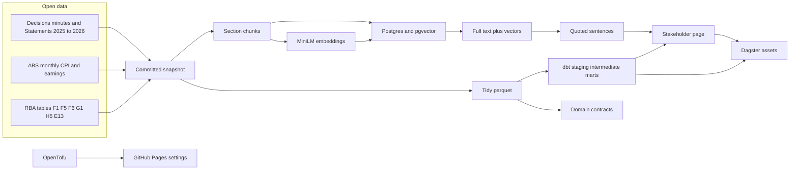

# RBA rate-shock copilot

[](https://github.com/LuciferDataEngineer/rba-rate-shock-copilot/actions/workflows/ci.yml)
[](https://luciferdataengineer.github.io/rba-rate-shock-copilot/)
[](LICENSE)

**Live page:** [https://luciferdataengineer.github.io/rba-rate-shock-copilot/](https://luciferdataengineer.github.io/rba-rate-shock-copilot/)

A free page for households, brokers and anyone else trying to read the Reserve Bank before the 3 November 2026 cash-rate decision. It answers two questions. What is the Bank actually saying about why rates are rising? And what does each rise cost an Australian mortgage?

The cash rate is **4.60%**. Four rises in 2026 have lifted it by 1 percentage point since January. On the average variable rate people are actually paying, a $600,000 loan costs about **$268 more a month** than it did in January. The September rise is not in that mortgage figure yet. Another quarter of a point, fully passed on, is about **$98 a month** on $600,000. Prices are **4.3%** higher than a year ago. Underlying inflation is **3.6%**, still above the 2–3% target. The findings are in [INSIGHTS.md](INSIGHTS.md). The page is not financial advice.

This snapshot was taken at **9:22am, Sunday 1 November 2026 (Melbourne time)**.

## The problem

The Monetary Policy Board meets on Tuesday 3 November 2026 at 2:30pm AEDT. All four major banks have said they expect a fifth rise, to 4.85%. A household deciding whether to fix, refinance or just rework the budget does not need a model of the cash rate. They need the Bank’s own sentences, dated and linked, and a plain dollar figure for what the rises so far have done to a repayment.

## Architecture



DuckDB is the warehouse. Postgres is only there for hybrid search. The page does not mention either.

## Tech stack, and why

| Piece | Choice | Why |
| --- | --- | --- |
| Warehouse | DuckDB | The default engine for this series. A few decades of monthly rates is a single file. |
| Transforms | dbt-duckdb | Staging, intermediate and marts, with tests on the cash rate, unemployment and the comparison repayment. |
| Semantic layer | dbt semantic models and a saved query | Seven metrics, including the real cash rate, the inflation gap, repayment per $100,000, the cumulative rise in basis points, and the repayment as a share of one wage. `dbt build` parses them. |
| Documents | 63 RBA pages, 2025–2026 | Decisions, minutes, and Statement chapters. CC BY 4.0. |
| Chunks | Section windows with overlap | A quote should stay inside one section, with a little shared text so a sentence on the boundary is not lost. |
| Embeddings | sentence-transformers, `all-MiniLM-L6-v2`, CPU | No paid API. 384 dimensions. Small enough for CI. |
| Search store | Postgres 16 with pgvector, HNSW | Full-text and vectors in one database. Docker locally, a service container in CI. |
| Hybrid search | Full text, vectors, and a direct phrase match, fused by document | The decisions are written in the same language. A rate and a month have to be able to outrank a longer chapter that uses the same words. |
| Answers | Extractive | The page quotes a sentence and links the Reserve Bank page. No generative model is required. |
| Evaluation | 32 hand-written questions | Recall@5, MRR and nDCG for full text, vectors, hybrid, and hybrid with a tie-break rerank. CI fails if hybrid recall@5 drops below 0.85. |
| Benchmark | Numpy exact, pgvector HNSW, DuckDB VSS | [BENCHMARKS.md](BENCHMARKS.md). All local. Cost $0. |
| Orchestration | Dagster assets and asset checks | The snapshot, the headline and the page, with checks that the corpus is large enough and the cash rate is 4.60%. |
| Lineage | An OpenLineage run event | `reports/openlineage/tidy_run.json`. No collector to run. |
| Contracts | Three domains, checked with pydantic | Policy documents, macro indicators, household finance. Schema, quality and freshness against the snapshot date. |
| Page | Static HTML | GitHub Pages. No server. |
| IaC | OpenTofu, GitHub provider | Describes the public repo and workflow Pages. CI runs `tofu validate`. It does not apply. |

Nothing here uses a paid API, a hosted vector database, or a hyperscaler.

## What's new versus vic-heat-health-sentinel

The previous project, [vic-heat-health-sentinel](https://github.com/LuciferDataEngineer/vic-heat-health-sentinel), answered a different question: which Victorian areas face dangerous heat, and who lives there? Its stack was Redpanda, PyFlink event-time windows, Delta Lake, a Feast feature store, scikit-learn with MLflow, Evidently drift, dbt-duckdb, Dagster, OpenTofu and a kind cluster.

This project keeps Dagster, dbt-duckdb and OpenTofu, and changes the rest because the problem changed.

- **Documents, not a temperature stream.** The new material is what the Reserve Bank wrote. There is no event log to window.
- **Hybrid retrieval instead of a feature store.** Chunks, local embeddings, pgvector and full text. The previous project had no documents and no search index.
- **A measured retrieval test.** Thirty-two questions with the page that should have answered them. CI fails if hybrid recall@5 falls below 0.85. The previous project measured a classifier, not a search.
- **A semantic layer on the mart.** Real cash rate, inflation gap, repayment per $100,000, cumulative basis points, and repayment against one wage are declared as metrics. The previous project stopped at tested marts.
- **Data contracts by domain.** Policy documents, macro indicators and household finance each have an owner and a contract. The previous project checked a manifest and dbt tests.
- **A search benchmark with a $0 cost.** pgvector HNSW, DuckDB VSS and exact numpy, written up with the caveat that 2,000 paragraphs do not need an index for speed.

Redpanda, Flink, Delta, Feast, MLflow and Evidently are not in this repo. They solved a streaming and modelling problem. This one is a reading problem with a repayment attached.

## Data sources

All free. No API key. Each file is in `data/manifest.json` with a SHA-256, a row count where that makes sense, and the access time. Accessed **1 November 2026, Melbourne time**.

| Dataset | Publisher | URL | Licence | Coverage |
| --- | --- | --- | --- | --- |
| F1 cash rate, daily | RBA | https://www.rba.gov.au/statistics/tables/csv/f1-data.csv | CC BY 4.0 | Cash rate target and the overnight cash rate. ASX and FENICS columns are in the file and are dropped |
| F1.1 cash rate, monthly | RBA | https://www.rba.gov.au/statistics/tables/csv/f1.1-data.csv | CC BY 4.0 | Monthly averages. Same third-party columns dropped |
| F5 indicator lending rates | RBA | https://www.rba.gov.au/statistics/tables/csv/f5-data.csv | CC BY 4.0 | Only the APRA series and the RBA securitisation series. Canstar columns are dropped |
| F6 housing lending rates | RBA, from APRA | https://www.rba.gov.au/statistics/tables/csv/f6-data.csv | CC BY 4.0 | Outstanding and new housing rates. Source row is APRA, RBA |
| G1 consumer price inflation | RBA, from ABS | https://www.rba.gov.au/statistics/tables/csv/g1-data.csv | CC BY 4.0 | Quarterly CPI and the trimmed mean |
| H5 labour force | RBA, from ABS | https://www.rba.gov.au/statistics/tables/csv/h5-data.csv | CC BY 4.0 | Unemployment rate and the rest of the labour-force block |
| E13 housing loan payments | RBA, from APRA and ABS | https://www.rba.gov.au/statistics/tables/csv/e13-data.csv | CC BY 4.0 | Scheduled repayments and the ratio to income |
| Monthly CPI | ABS Data API | https://data.api.abs.gov.au | CC BY 4.0 | All-groups CPI and the trimmed mean, year-ended, through September 2026. Table G1 is quarterly, so the monthly 4.3% is read from the ABS |
| Average weekly earnings | ABS Data API | https://data.api.abs.gov.au | CC BY 4.0 | Full-time adult ordinary-time earnings, persons, Australia, seasonally adjusted |
| Decisions, minutes, Statements | RBA | https://www.rba.gov.au/monetary-policy/ | CC BY 4.0 | 14 decisions, 14 sets of minutes, 35 Statement chapters, 2025–2026 |

Source: RBA. ABS series are CC BY 4.0. The raw CSVs are stored whole so the exclusion of Canstar, ASX and FENICS can be checked.

## Cleaning and transformation

1. Parse each RBA CSV, which has a title row, a source row and a series-id row above the observations.
2. Keep a series only when every publisher named in the source row is the RBA, the ABS or APRA. “Securitisation System” is the RBA’s own system and stays. Canstar, ASX and FENICS go.
3. Treat blanks and `N/A` as missing. The cash-rate file often leaves the change column empty, so a rise is a change in the target itself.
4. Read the ABS SDMX CSVs for the monthly CPI and earnings.
5. Build a month spine from 2022. Cash rate is the last target in the month. Housing rate, unemployment and inflation join on the month.
6. The comparison repayment is principal-and-interest, 30 years, monthly. The annual rate is divided by 12. January 2026 is the baseline for “since January”.
7. The real cash rate is the cash rate target minus the year-ended trimmed mean. The inflation gap is that trimmed mean minus 2.5, the middle of the target.
8. Documents are extracted from the saved HTML. Navigation is dropped. Text is split on headings, then into overlapping sentence windows of about 850 characters.
9. Theme shares count chunks that mention energy, AI and investment, capacity and productivity, or jobs and wages. The page uses that count. It does not mention embeddings.

## Data model

| Layer | Table | Grain |
| --- | --- | --- |
| Snapshot | RBA CSVs, ABS CSVs, HTML and text | As published |
| Tidy `series_long` | one row per series per date | Allowed series only |
| Tidy `documents`, `chunks` | one row per document, one per chunk | 63 documents, 2,095 chunks |
| Tidy `theme_monthly` | one row per month per theme | Share of chunks |
| dbt staging | the tidy tables, typed | Views |
| dbt intermediate | cash rate, housing rate, labour, inflation, policy changes, payment ratios | Month, or one row per change in the target |
| `mart_household_month` | one row per month from 2022 | Cash rate, prices, unemployment, repayment, real cash rate |
| `mart_decisions` | one row per change in the target since 2024 | Basis points |
| Semantic model `household_month` | the monthly mart | Metrics below |
| Postgres `chunks` | one row per chunk | Text, `tsvector`, `vector(384)`, HNSW and GIN indexes |

Metrics declared for MetricFlow, and parsed by `dbt build`:

| Metric | Meaning |
| --- | --- |
| `cash_rate` | Month-end cash rate target |
| `real_cash_rate` | Cash rate minus year-ended trimmed mean |
| `inflation_gap` | Trimmed mean minus 2.5 |
| `repayment_per_100k` | Monthly repayment per $100,000 over 30 years |
| `cumulative_hike_bp` | Basis-point change in the cash rate since January 2026 |
| `mortgage_repayment_to_income` | Repayment on $600,000 divided by one full-time ordinary-time wage |

`dbt build` reports the saved query `household_metrics_by_month`. The `metricflow` 0.213 library installs, but it does not ship an `mf` command, and dbt 1.9 does not provide `dbt sl query`. The page therefore reads the mart directly. The metric definitions and the mart are the same columns.

Domains and owners:

| Domain | Owner | Contract |
| --- | --- | --- |
| `policy_documents` | LuciferDataEngineer | `contracts/policy_documents.yaml` |
| `macro_indicators` | LuciferDataEngineer | `contracts/macro_indicators.yaml` |
| `household_finance` | LuciferDataEngineer | `contracts/household_finance.yaml` |

Freshness is measured against the snapshot’s access time, not the wall clock, so CI still passes when the snapshot is old.

## Retrieval

Chunks keep their section heading. Overlap is about 140 characters. Embeddings are `sentence-transformers/all-MiniLM-L6-v2` on CPU, L2-normalised, stored in pgvector with an HNSW cosine index. Full text uses a generated `tsvector`.

Hybrid ranking is by document, not by chunk. Full text and vectors contribute reciprocal rank. A direct match on a rate, a month or a less common word adds its weight, and a document dated in a year the question names gets a further boost. That is what separates the September 2026 decision from every other page that also says “cash rate” and “inflation”. A lexical pass then breaks ties. It does not overturn a strong match, which is why hybrid and hybrid-plus-rerank land on the same numbers. A cross-encoder rerank is optional (`RBA_RERANK=cross`, model `cross-encoder/ms-marco-MiniLM-L-6-v2`) and is not required for CI.

Answers are a sentence from the retrieved passage, with the document title, date and URL.

Thirty-two questions are in `eval/golden.yml`. A question can list the decision and the minutes of the same meeting when both state the fact. Recall is the share of those pages found in the top five.

| Method | Recall@5 | MRR | nDCG@5 |
| --- | ---: | ---: | ---: |
| Full text only | 0.156 | 0.137 | 0.118 |
| Vectors only | 0.312 | 0.213 | 0.206 |
| Hybrid | **0.969** | 0.669 | 0.740 |
| Hybrid, tie-break rerank | 0.969 | 0.669 | 0.740 |

Full text alone struggles because the decisions share a vocabulary. Vectors alone do better and still confuse one hike with another. The hybrid is what clears the bar. CI fails if hybrid recall@5 falls below **0.85**.

## Benchmark

On 8,000 vectors built from the real embeddings, exact numpy search of 25 queries took 0.9 ms, pgvector HNSW 19.7 ms and DuckDB VSS 47.6 ms. Both indexes matched the exact neighbours. The write-up, including the $0 cost and the fact that numpy batches the 25 queries while the databases do not, is in [BENCHMARKS.md](BENCHMARKS.md).

## Run it

Python 3.11 or 3.12.

```bash
python -m venv .venv
source .venv/bin/activate
pip install -e ".[dev,dbt,rag,orch]"

make pipeline     # tidy parquet from the committed snapshot
make dbt          # tested marts and parsed metrics
make contracts
make dashboard    # site/index.html from the mart and reports/answers.json

docker compose -f infra/docker-compose.yml up -d
make rag          # embeddings into Postgres, then the quoted answers
make eval         # recall, MRR, nDCG; fails under 0.85
make benchmark
make tofu         # tofu validate only
make test
```

CI does not scrape. `make snapshot` is the only target that calls the RBA and the ABS, and it is polite about it: a browser user agent and a short pause between pages.

## Testing and CI

- `ruff check` and `pytest` for the repayment formula, the source filter, chunk overlap, rank fusion and the 2026 rises.
- `dbt build` for the marts and the semantic model.
- Contract checks for the three domains.
- A headline check that the cash rate is 4.60, there are four rises in 2026, September CPI is 4.3, the trimmed mean is 3.6, and unemployment is 4.7.
- pgvector in a GitHub Actions service container, with the embedding model cached, running the retrieval eval.
- `tofu validate` for the GitHub repo and Pages settings.
- `dagster definitions validate` for the asset graph.
- Pages: `actions/upload-pages-artifact` and `actions/deploy-pages` on a push to `main`.

An OpenLineage JSON event for the tidy step is written to `reports/openlineage/tidy_run.json`. Dagster’s asset graph is the other lineage view: snapshot, headline, page.

## Limitations and next steps

- The housing-rate table ends in August 2026. The 30 September cash-rate rise is not in the $268 figure. The page says so.
- The 41% of one wage is not a typical household. Many mortgages are paid from two incomes. The economy-wide ratio, 9.4% of disposable income, is the published aggregate and it is only through March 2026.
- The quarterly CPI and the monthly CPI are different series. Both are cited. The page leads with the monthly 4.3%.
- Bank forecasts of 4.85% are attributed to reporting by Savings.com.au. They are not in an official table and they are not a Reserve Bank decision.
- `mf query` is not available from the open-source packages that installed here. The metrics are parsed. They are not executed by the MetricFlow CLI.
- The lexical rerank only breaks ties, so it does not move recall. A cross-encoder is wired up and was not part of the measured table.
- A kind cluster for Postgres was left out so the retrieval test and the page could land.
- The next decision, on 3 November, is not in the snapshot. Refreshing the page after that meeting means `make snapshot` and a rebuild.
